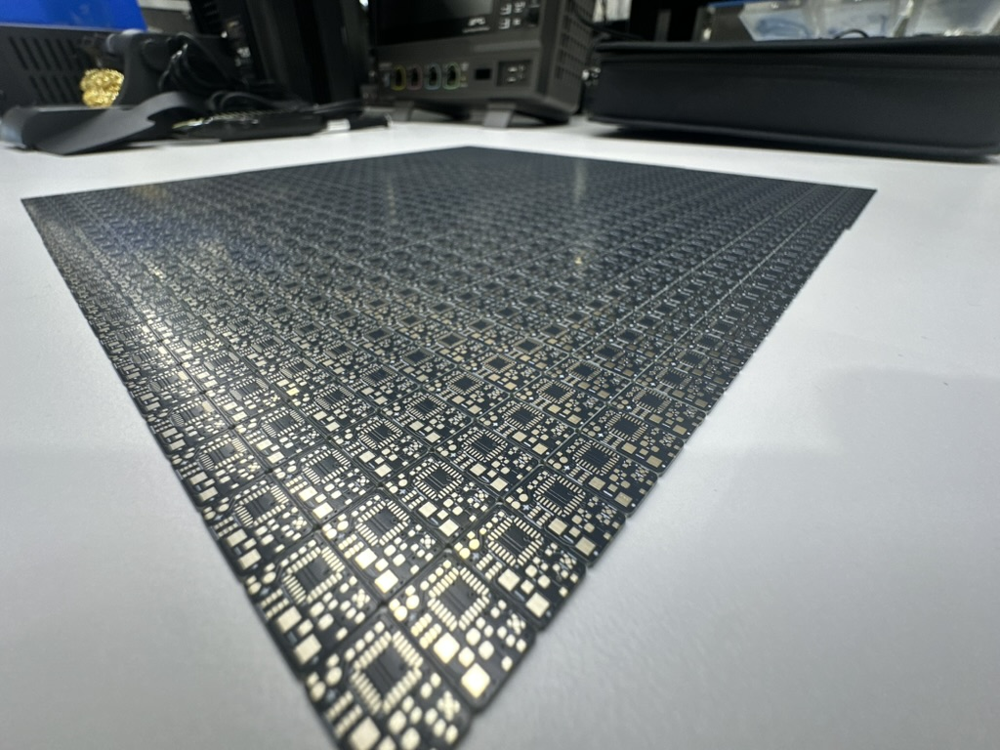
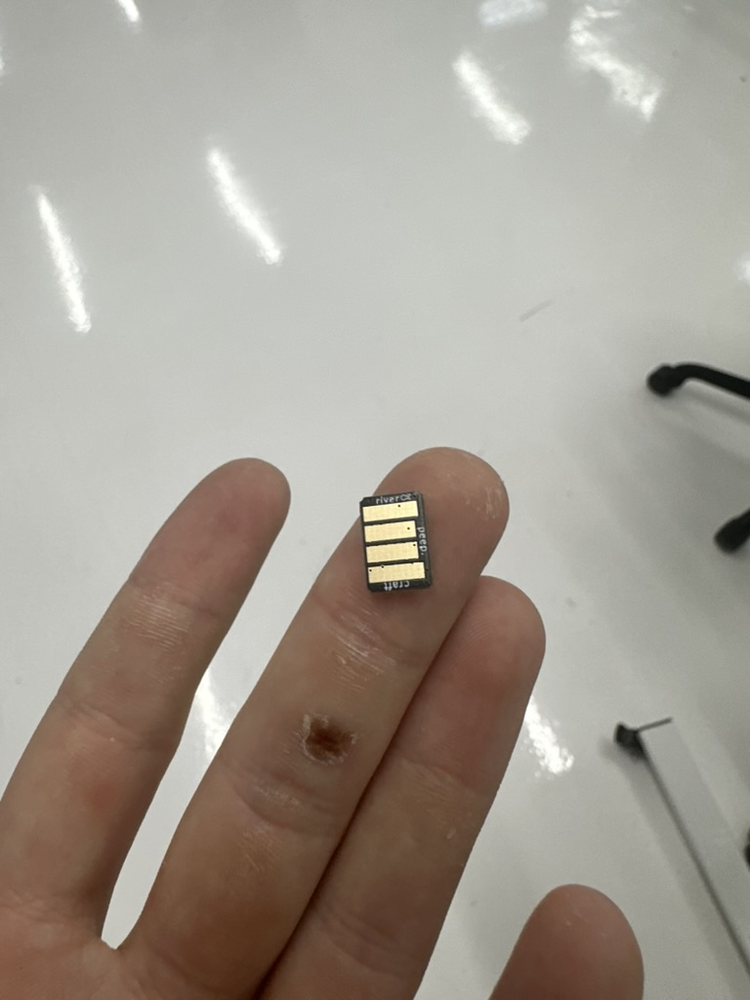
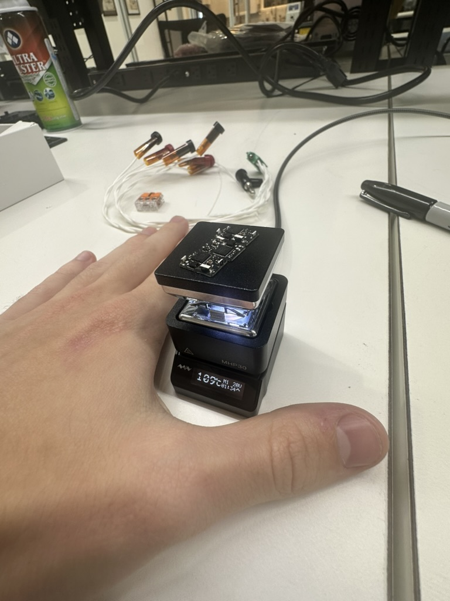

# PCB projects

Open [peep/peep.kicad_pro](peep/peep.kicad_pro) in KiCad 10. The BOM, placement files, and Gerbers are in [peep/production/](peep/production/).

Custom symbols, footprints, and 3D models come from `RiversKicadLibrary` through the `RIVERS_DIR` KiCad path variable.

The [ESP32-C6 remote](../software/firmware/esp32-trigger/README.md) uses off-the-shelf boards; there is no remote PCB yet.

## On the bench

