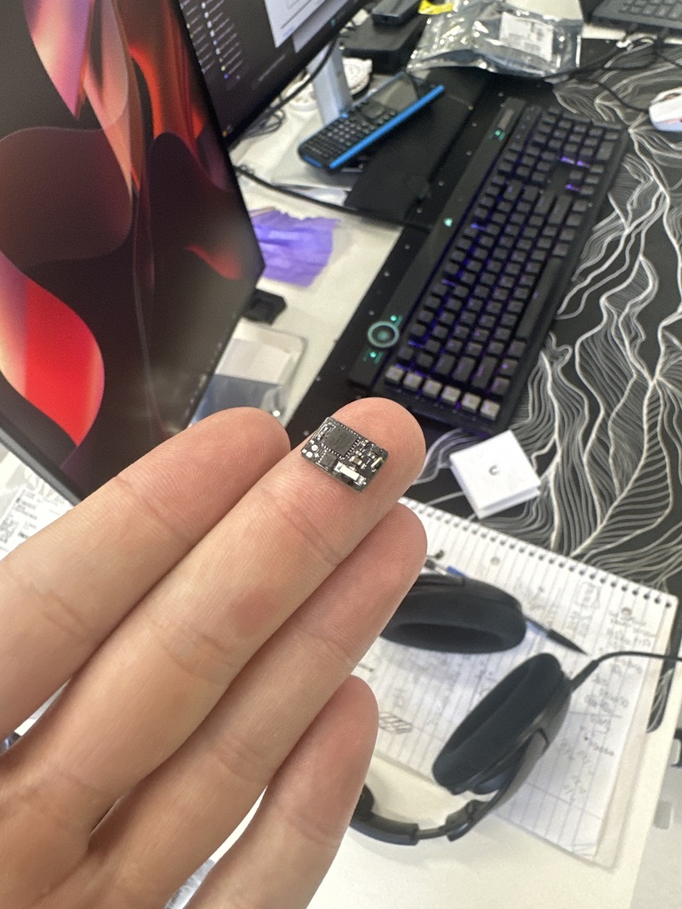
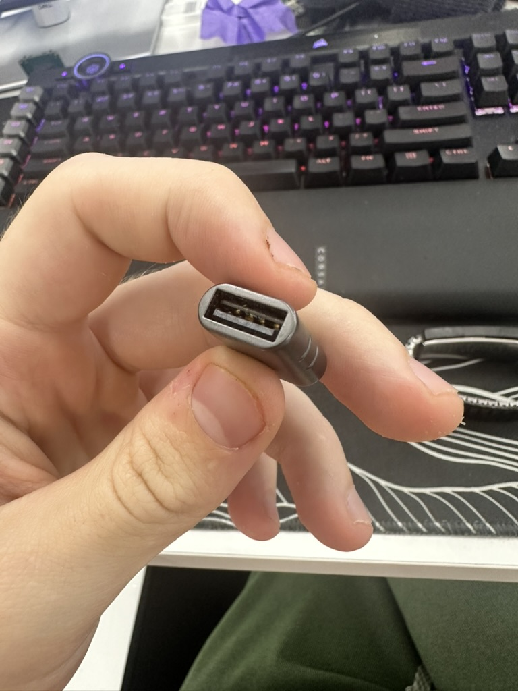

# PEEP

A 12.06 × 8 mm infrared-triggered USB keyboard.

How small can a useful USB automation device get? PEEP is my attempt to find out.

<!-- Add a demo thumbnail and video link here. -->

## Hardware

- Four-layer, 0.8 mm PCB with a direct USB-A edge connection
- STM32F042G6 Cortex-M0 with crystal-less USB Full Speed
- VEMD10940F photodiode and VSOP38338 38 kHz IR receiver
- Factory USB DFU bootloader; bridge BOOT0 to 3.3 V for recovery

## Software

An IR burst starts the stored macro. PEEP sends standard USB keyboard reports, ignores IR while the macro runs, then re-arms after 250 ms of idle receiver time. Plugging it in does not start the demo.

- [Firmware, build, and flashing instructions](software/firmware/README.md)
- [XIAO ESP32-C6 Wi-Fi / IR remote](software/firmware/esp32-trigger/README.md)
- [KiCad project](PCB/peep/peep.kicad_pro) and [PCB setup](PCB/README.md)
- [BOM and production files](PCB/peep/production/)

There is no Windows companion or packet-upload protocol yet.

The firmware builds and passes native tests; the IR path still needs an on-board check.

Use PEEP only on systems you own or have permission to test.

[MIT license](LICENSE). Dependencies retain their own licenses.

